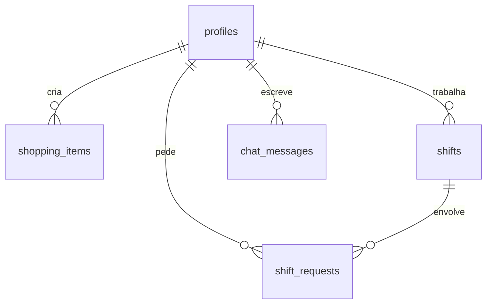

# 04 Modelagem

Fonte de verdade: `supabase/schema.sql`. Tabelas em inglês, comentários em português.

| Tabela | Para que serve | Campos principais |
|---|---|---|
| `profiles` | Pessoa da equipe (1:1 com `auth.users`) | nome, telefone, papel (`dono`/`gerente`/`funcionario`), ativo |
| `shopping_items` | Lista de compras | nome, quantidade, tipo (`insumo`/`produto`), urgente, status, criado_por, comprado_por, comprado_em |
| `shifts` | Turnos da escala | profile_id, data, inicio, fim, observacao |
| `shift_requests` | Pedidos de troca e folga | tipo (`troca`/`folga`), solicitante_id, shift_id, substituto_id, data, motivo, status, decidido_por |
| `chat_messages` | Chat da equipe | sala (`compras`/`escalas`), autor_id, texto |

- Toda tabela tem `created_at` e `updated_at`.
- Sem `tenant_id` (ADR-002).
- Horas são calculadas na consulta (view `v_horas_semana`), não guardadas.
